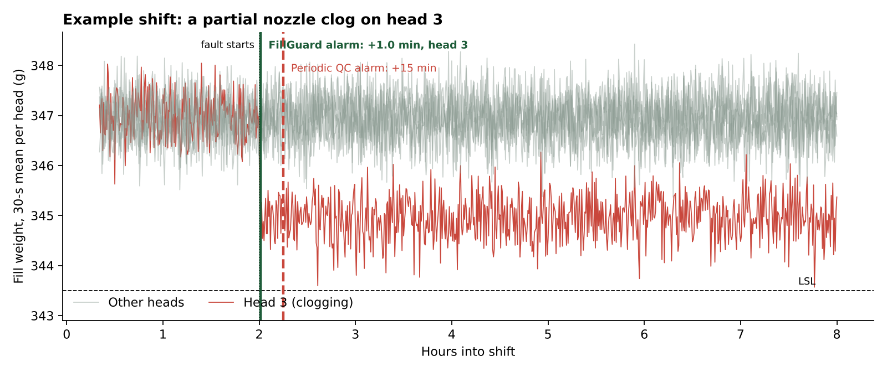
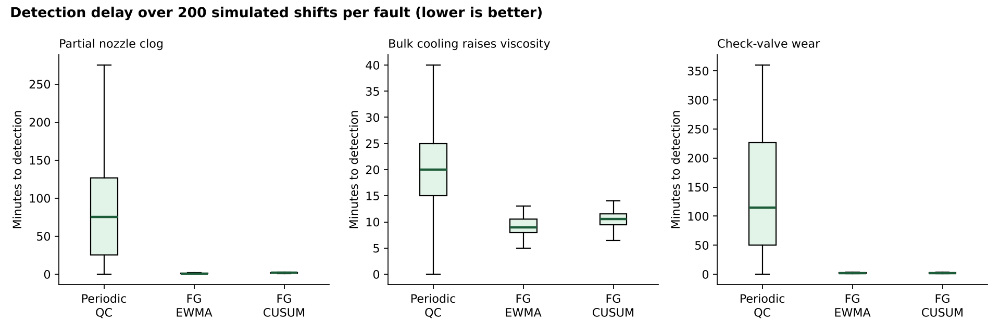
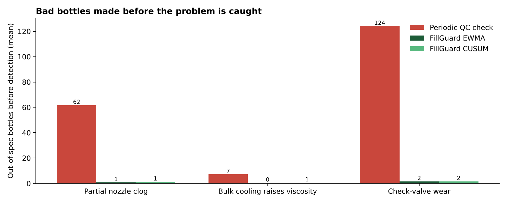

# FillGuard: early warning for fill-weight drift on a filling line

**Catch a drifting filling head in minutes, not hours, using data the checkweigher already collects.**

Most filling lines check quality the old way: every few minutes someone weighs a handful of bottles and compares the average with a 3-sigma limit. That check is blind to a fault on *one* head of a six-head filler, because the other five heads dilute it. FillGuard monitors every head separately on 100% checkweigher data with EWMA/CUSUM control charts, and calibrates its thresholds so that it raises **no more false alarms than the periodic check**.

> All data in this project are **simulated** from a documented process model (below). The model, the calibration and the evaluation are real and reproducible; the line is not a real plant. The point is the method, which can be dropped onto real checkweigher exports.



## Results (200 simulated shifts per fault)

| Fault (injected at hour 2) | Method | Caught in shift | Median time to detect | 90th pct | Median out-of-spec bottles before detection | Faulty head identified |
|---|---|---|---|---|---|---|
| Partial nozzle clog, head 3 (−2 g) | Periodic QC check | 99% | 75 min | 195 min | 56 | not possible |
| | **FillGuard EWMA** | 100% | **1.0 min** | 1.5 min | **1** | **100%** |
| | FillGuard CUSUM | 100% | 2.0 min | 2.0 min | 1 | 100% |
| Bulk cooling raises viscosity, all heads (−0.06 g/min) | Periodic QC check | 100% | 20 min | 30 min | 5 | not possible |
| | **FillGuard EWMA** | 100% | **9 min** | 11 min | **0** | all heads |
| | FillGuard CUSUM | 100% | 10.5 min | 12 min | 0 | all heads |
| Check-valve wear, head 5 (scatter ×2) | Periodic QC check | 88% | 115 min | 360 min | 94 | not possible |
| | **FillGuard EWMA** | 100% | **2 min** | 3.5 min | **2** | **100%** |
| | FillGuard CUSUM | 100% | 2 min | 3.5 min | 2 | 100% |

False alarms on fault-free shifts (80 shifts): periodic check **0.78**, FillGuard EWMA **0.49**, FillGuard CUSUM **0.75** per shift. FillGuard is faster *and* no noisier.




**What this means on a line.** A clogged nozzle that the periodic check takes about 75 minutes to notice produces around 56 out-of-spec bottles, and about 750 bottles from that head are filled 2 g light. FillGuard flags it in about a minute and names the head, so the operator cleans one nozzle instead of stopping the line to hunt for the cause. Every bottle not rejected is product, packaging and energy not wasted.

## How it works

1. **Process model** (`fillguard/model.py`). Six-head piston filler at 60 bottles/min for an 8-hour shift (28,800 bottles). Target 347 g (340 ml × 1.02 g/ml), within-head σ = 1.0 g, small fixed offsets between heads after set-up, spec 343.5–350.5 g (target ± 3.5σ). Three realistic faults can be injected: a step on one head (partial nozzle clog), a slow drift on all heads (bulk cools, viscosity rises, piston under-fills), and extra scatter on one head (check-valve wear).
2. **Baseline** (`periodic_check_alarms`). Every 5 minutes QC weighs 5 bottles from random heads; alarm if the mean is outside target ± 3σ/√5.
3. **FillGuard** (`FillGuard.alarms`).
   - *Phase I*: learn each head's own mean from the first 20 minutes after start-up.
   - *Phase II*: group each head's fills into 30-second subgroups of 5 and run, per head, an EWMA (λ = 0.2) or tabular CUSUM (k = 0.5σ) on the mean, plus an upper EWMA (λ = 0.1) on the variance.
4. **Fair calibration** (`run_analysis.py`). Thresholds are raised step by step on 80 fault-free shifts until FillGuard's false alarms per shift are at or below the periodic check's. Result: mean EWMA L = 4.4, CUSUM h = 13, variance EWMA L = 0.8.
5. **Evaluation**. Each fault is injected into 200 independent shifts; we record time to detection, out-of-spec bottles made between fault onset and detection, and whether the alarm came from the faulty head.

## Run it

```bash
pip install -r requirements.txt
python run_analysis.py      # regenerates results.md, results.json and figures/ (~1 min)
pytest -q                   # 6 tests
streamlit run app.py        # interactive demo: inject a fault, watch both methods react
```

`data/example_shift_nozzle_clog.csv` holds one simulated shift (cycle, minute, head, fill weight) for anyone who wants to try their own method.

## Limitations and what real data would change

- Fill weights are simulated as independent normal noise; real lines show autocorrelation, which inflates false alarms and would need a residual-based chart.
- Head σ is assumed known (1.0 g); on a real line it would be estimated in Phase I.
- Spec limits are assumptions; the legal net-quantity tolerance for the pack size should be used.
- With real data, the next step is to validate the false-alarm rate on a month of normal production before trusting the thresholds.

## Project structure

```
fillguard/model.py      process model and fault definitions
fillguard/detect.py     EWMA, CUSUM, variance EWMA, periodic check
fillguard/evaluate.py   FillGuard monitor (Phase I/II) and metrics
run_analysis.py         calibration, Monte Carlo, tables and figures
app.py                  Streamlit demo
tests/                  unit tests
```

*Author: Pravin Kumar Mahato, B.Tech Chemical Engineering, BIT Mesra.*
